 

**We turn raw ideas into working products: fast, tested, shipped.**

## ⚡ What we do

| 💡 Brainstorm | 🛠 Build | 🚀 Ship |
| :--- | :--- | :--- |
| Find ideas worth testing and check them quickly | Telegram mini-apps, web services, bots | CI/CD, Docker, one-command deploys |

## 🧩 How we work

- **Small steps.** Short branches, small pull requests, quick reviews.
- **Quality first.** Every change is checked by CI before it reaches `main`.
- **Everything is automated.** Build, test and deploy run through GitHub Actions.

**Found a bug or have an idea?** Open an issue in the relevant repository.
Our default templates will guide you.

🧠 BrainStorm · Brainstorm. Build. Ship.

